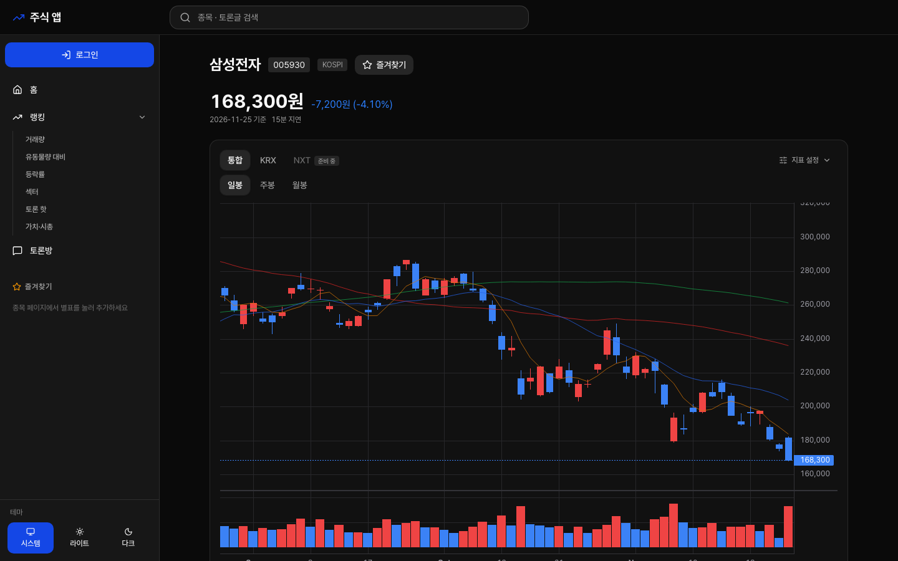
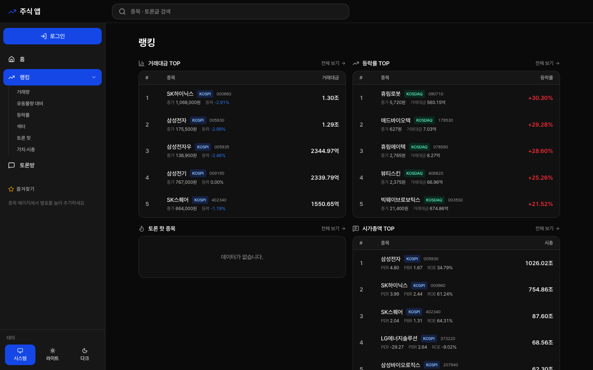
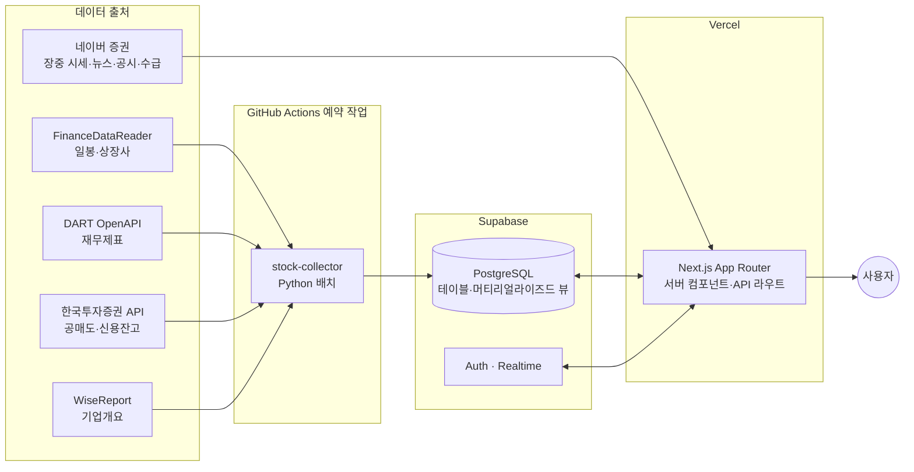

<div align="center">

# 📈 주식 앱

**국내 주식의 차트·기업정보·랭킹·토론을 한곳에서 보는 웹 서비스**

[](https://stock-web-lilac.vercel.app)


[사이트 바로가기](https://stock-web-lilac.vercel.app) · [기능](#주요-기능) · [구조](#구조) · [시작하기](#시작하기) · [문서](#문서)

</div>



## 주요 기능

### 📊 차트
- KOSPI·KOSDAQ 전 종목의 **일봉·주봉·월봉 캔들 차트**([Lightweight Charts](https://github.com/tradingview/lightweight-charts) v5)
- 보조지표: 이동평균선(5·20·60·120), 볼린저밴드, 거래량, RSI, OBV, **공매도 비중**, **신용잔고율**
- 장중에는 현재가를 마지막 봉에 덧붙여 30초마다 갱신(15분 지연)
- 날짜를 눌러 남기는 **차트 메모**, 모바일 핀치 줌과 롱프레스

### 🏢 종목 정보
- 기업정보·재무: 기업개요, PER·PBR·ROE·EPS·BPS, 배당, 5일·20일·52주 고저
- 시세(최근 20영업일), 투자자별 수급과 외국인 보유율, 뉴스, 공시 탭

### 🏆 랭킹
- 거래대금·거래량 급증, 등락률, 52주 신고가·신저가
- 시가총액·저PER·저PBR·고ROE, 유동물량 대비 거래량
- KRX 업종별 섹터 랭킹, 토론이 뜨거운 종목



### 💬 커뮤니티
- 종목별 토론방, 댓글·대댓글, 좋아요·싫어요
- Supabase Realtime으로 새 글과 반응을 **실시간 반영**, 무한 스크롤
- 토론 글마다 고유 주소와 OpenGraph·canonical(SEO)

### 👤 사용자
- Google 로그인, 닉네임 온보딩, 로그인 뒤 원래 페이지로 복귀
- **즐겨찾기**: 비로그인은 브라우저에 저장하고, 로그인하는 순간 서버로 합침
- 라이트·다크·시스템 테마(첫 화면 깜빡임 없음), 데스크톱·모바일 반응형

## 구조



- **웹**: Next.js 16 App Router가 Vercel에서 돈다. 종목·랭킹·재무는 Supabase에서, 장중 시세·뉴스·공시·수급은 API 라우트가 네이버 증권에서 받아 캐시해 내려 준다.
- **수집**: `stock-collector/`의 Python 배치를 GitHub Actions가 일정대로 돌려 운영 DB에 쓴다.
- **DB**: `supabase/migrations/`의 마이그레이션은 `main`에 올라가면 워크플로가 운영 DB에 적용한다. 랭킹은 머티리얼라이즈드 뷰로 미리 계산해 둔다.

### 수집 일정(KST)

| 작업 | 일정 | 출처 → 테이블 |
| --- | --- | --- |
| 일봉·투자 지표 | 평일 16:00 | FinanceDataReader → `candles`, `stocks`, `financials`(PER·PBR·ROE 등 계산), 랭킹 뷰 갱신 |
| 공매도·신용잔고 | 평일 18:30 | 한국투자증권 Open API → `short_sales`, `credit_balances` |
| 기업 기본 정보 | 월 09:00 | pykrx·FinanceDataReader·DART → `stocks` |
| 재무제표 | 월 10:00 | DART 연결재무제표 최근 4분기 → `financials` |
| 기업개요 보강 | 월 12:00 | WiseReport → `stocks`, `financials` |

## 기술 스택

| 영역 | 사용한 것 |
| --- | --- |
| 프론트엔드 | Next.js 16 (App Router), React 19, TypeScript, Tailwind CSS v4, shadcn/ui, lucide-react |
| 차트 | TradingView Lightweight Charts v5 |
| 백엔드·데이터 | Supabase(PostgreSQL, RLS, Auth, Realtime), Next.js API 라우트 |
| 수집 | Python 3.10, FinanceDataReader, pykrx, DART OpenAPI, 한국투자증권 Open API |
| 인프라 | Vercel(웹), GitHub Actions(수집·마이그레이션) |
| 품질 | Vitest, ESLint, `tsc`, 색인 점검 스크립트 |

## 시작하기

Node.js 20.9 이상이 필요합니다.

```bash
npm ci
cp .env.example .env.local   # 값을 채웁니다
npm run dev                  # http://localhost:3000
```

`.env.local`에는 `NEXT_PUBLIC_SITE_URL`(로컬은 `http://localhost:3000`), Supabase URL과 anon key를 넣습니다. DB 테이블과 종목 데이터, Google 로그인 설정은 따로 준비해야 합니다. 자세한 절차는 [실행 안내](docs/05-running.md)에 있습니다.

| 명령 | 용도 |
| --- | --- |
| `npm run dev` | 개발 서버 |
| `npm run build` / `npm run start` | 배포용 빌드와 실행 |
| `npm run lint` | 린트 |
| `npm test` | 단위 테스트(Vitest) |
| `sh tool/check.sh` | 커밋 전 검사 전부: 타입·린트·테스트·수집 스크립트 문법·색인 |

## 폴더

```
src/
  app/          페이지와 API 라우트 (App Router)
  components/   화면 조각 (차트, 종목, 토론, 검색, 레이아웃)
  contexts/     공유 상태 (인증, 즐겨찾기, 사이드바)
  hooks/        클라이언트 훅
  lib/          순수 함수·상수·Supabase 클라이언트
  types/        DB·도메인 타입
stock-collector/  Python 수집 배치
supabase/         마이그레이션과 설정
test/             Vitest 단위 테스트
docs/             색인·작업 기록·결정·설명서
```

## 문서

- **[처음 읽는 사람을 위한 설명서](docs/README.md)**: React·Next.js를 모르는 독자를 기준으로 실제 소스를 따라 설명합니다(2026-09-23 소스 기준).
  [전체 구조](docs/01-big-picture.md) · [코드 읽기](docs/02-reading-code.md) · [파일 지도](docs/03-file-map.md) · [데이터 흐름](docs/04-data-flows.md) · [실행](docs/05-running.md) · [실습](docs/06-practice.md)
- **[프로젝트 색인](docs/INDEX.md)**: 기능·API·DB 테이블·수집 작업·설정값에서 파일로 찾아 들어가는 표
- **[작업 기록](docs/history/README.md)**, **[결정과 일하는 방식](docs/decisions.md)**: 무엇을 왜 그렇게 했는지

이 저장소는 AI 코딩 에이전트와 함께 만듭니다. 에이전트가 읽는 작업 규칙은 [AGENTS.md](AGENTS.md)와 [CLAUDE.md](CLAUDE.md), 폴더마다 있는 `CLAUDE.md`에 있습니다.

## 알려 둘 것

- 시세는 15분 지연이며, 이 사이트의 정보는 투자 권유가 아닙니다.
- NXT 단독 차트는 준비 중입니다.
- 시세·재무 데이터의 권리는 각 출처(KRX, DART, 한국투자증권, 네이버 증권, WiseReport)에 있습니다.
